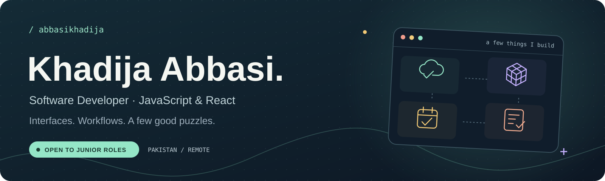
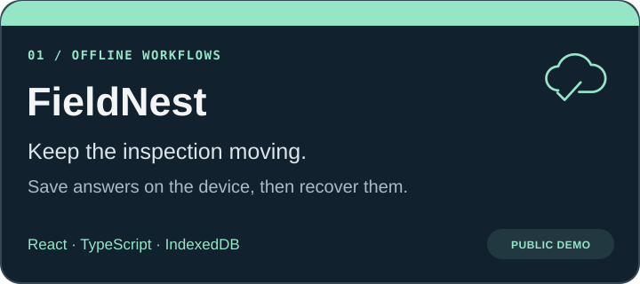
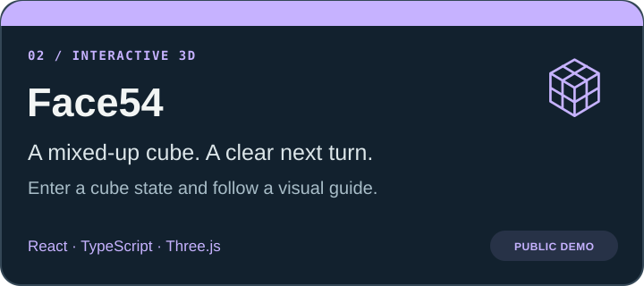
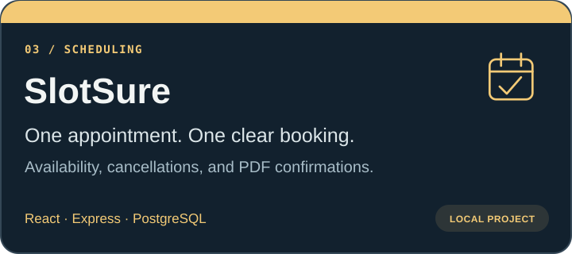
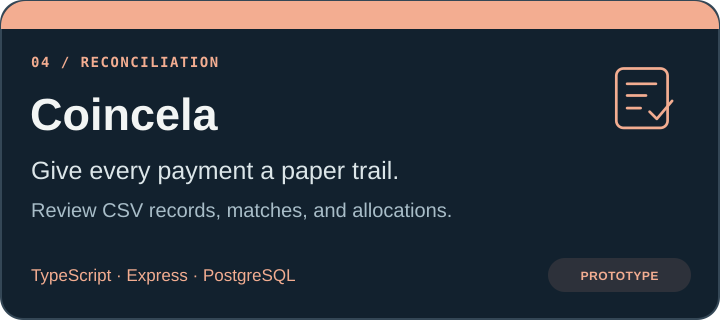

  

  <a href="https://abbasikhadija.github.io/portfolio/"><strong>Explore my portfolio ↗</strong></a>
  &nbsp; · &nbsp;
  <a href="https://www.linkedin.com/in/khadija-abbasi/"><strong>Let’s connect ↗</strong></a>

### Hey, I’m Khadija 👋

I work on web applications, from inspection forms that keep your answers when the connection drops to a 3D guide for that stubborn Rubik’s Cube.

I’m interested in the parts between the screens: where a booking becomes a reservation, a draft becomes saved work, and an error becomes something a person can recover from.

**Based in Pakistan · Open to junior software development roles, including remote opportunities.**

### 🧰 In the project toolbox

  
  
  
  
  
  
  
  

Also used across my work: **HTML · CSS · Git · GitHub · Vite**

### 🚀 A few things I’ve been building

<table>
  <tr>
    <td width="50%" valign="top">
      
      
<a href="https://abbasikhadija.github.io/fieldnest/">Try the demo ↗</a> &nbsp; · &nbsp; <a href="https://github.com/abbasikhadija/fieldnest">Read the code</a>

    </td>
    <td width="50%" valign="top">
      
      
<a href="https://abbasikhadija.github.io/Face54/">Try the demo ↗</a> &nbsp; · &nbsp; <a href="https://github.com/abbasikhadija/Face54">Read the code</a>

    </td>
  </tr>
  <tr>
    <td width="50%" valign="top">
      
      
<a href="https://github.com/abbasikhadija/SlotSure">Explore the project ↗</a>

    </td>
    <td width="50%" valign="top">
      
      
<a href="https://github.com/abbasikhadija/Coincela">Explore the project ↗</a>

    </td>
  </tr>
</table>

### 🍦 A little systems work, too

**[ConeCurrency](https://github.com/abbasikhadija/ConeCurrency)** is a team project involving a C-based TCP ordering server. My documented contribution focuses on networking, sequential request handling, and supporting test and benchmark tooling.

  
<strong>🔎 Behind the projects</strong>

My work includes project scoping, user journeys, interface decisions, AI-assisted development, and functional checks. The [portfolio case studies](https://abbasikhadija.github.io/portfolio/) explain my contributions, the application features, and what I have personally tested.

---

  <strong>Have a junior developer opportunity in mind?</strong> 
  <a href="https://www.linkedin.com/in/khadija-abbasi/">Let’s talk on LinkedIn</a> · <a href="https://abbasikhadija.github.io/portfolio/">Take a look around my portfolio</a>

